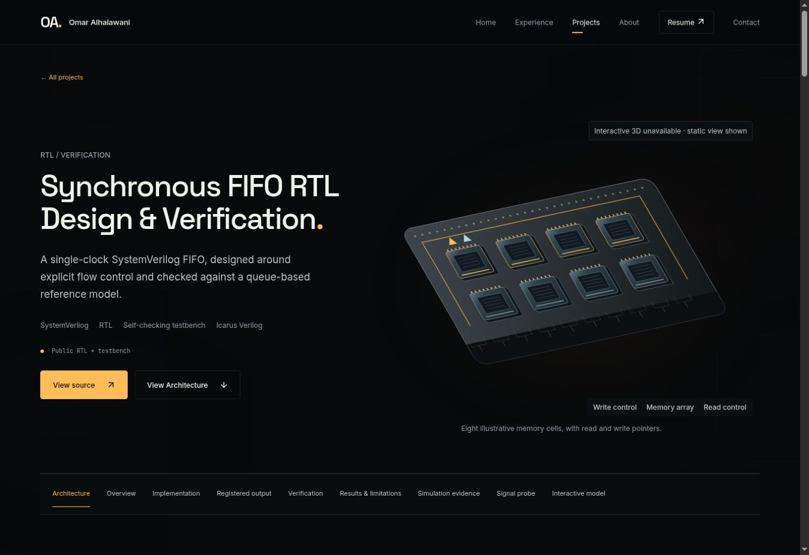

# 3D materials and text clarity

Hardware uses finer brushed grain, reduced bump strength, smoother desktop plate bevels and a higher-resolution shared softbox environment. Bloom is more restrained on hardware; Contact keeps its existing bloom settings. Exposure, mobile DPR, cameras, dock footprints and animation timelines are unchanged.

Fixed 512×128 bitmap label strips were replaced by signed-distance-field glyphs from a locally bundled JetBrains Mono font. Labels wrap without horizontal squeezing. A projected-size check omits engravings below readable size, with 11/13px hysteresis to prevent flicker; primary information remains in readable HTML labels, platform names and the verification workflow. Tiny decorative text has been removed from PCB textures. Glyph generation uses the CPU option and the font atlas is shared.

Hardware fallback images are now text-free vector technical illustrations rather than low-resolution raster engravings. Their component labels remain in HTML at 12px. The Contact globe's existing text-free artwork remains. Actual FIFO waveform evidence stays SVG and can scroll horizontally at a readable width on small screens. Existing raster posters remain archived but are no longer used as hardware scene fallbacks.

Validation: production build, typecheck and all 23 tests passed. Tests cover long-label word preservation and width constraints, character normalization and vector fallback selection. The managed browser confirms the FIFO labels/caption at 12px with no page overflow. That cloud browser has WebGL disabled, so live SDF lettering and the material changes could not be visually verified on a GPU here; the screenshot shows the static fallback and HTML labels. No physical-device performance claim is made.

