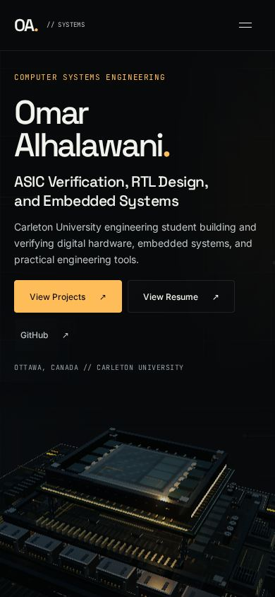
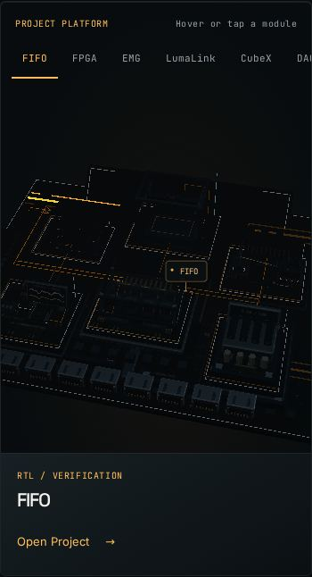
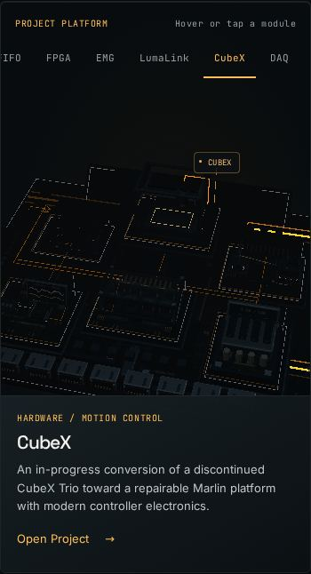
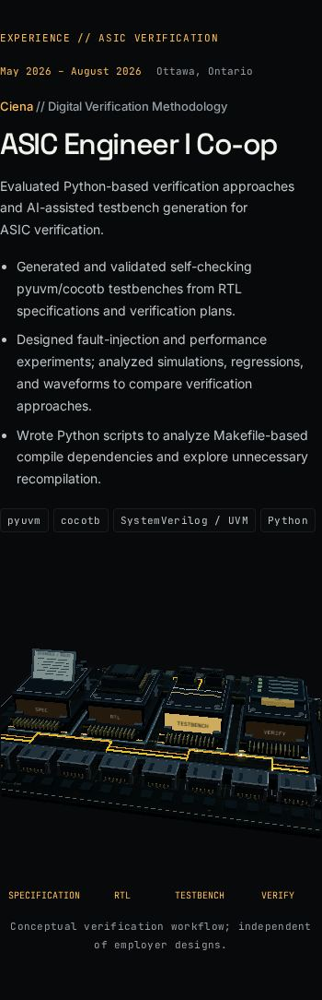
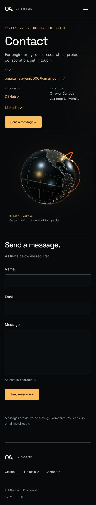
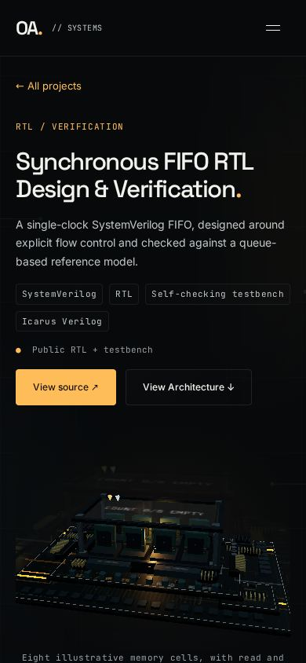
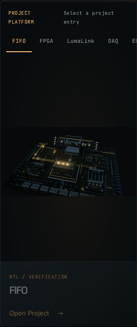
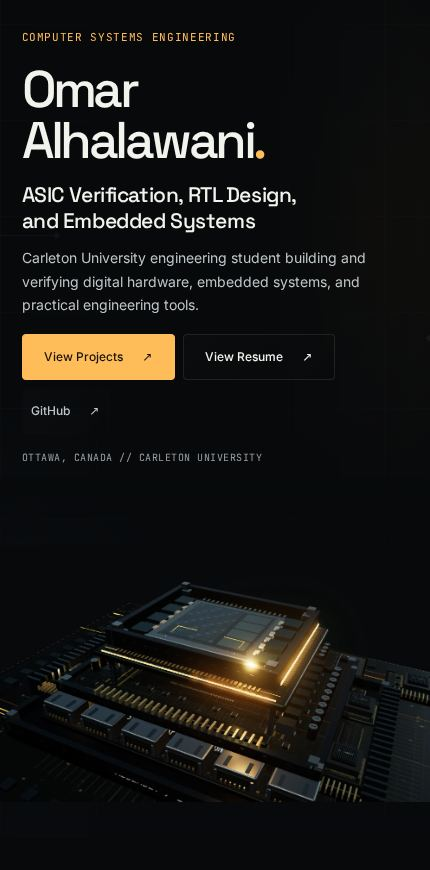
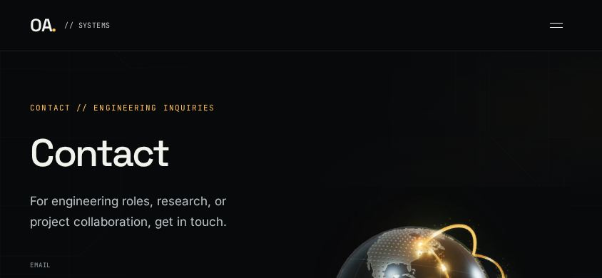

# Mobile-first refinement

1. **Projects:** integrated context sheet, synced 44px horizontal selectors, concise mobile titles, and single-tap selection. Explicit Open Project retains the existing camera handoff. Invisible dock hit regions and physical footprints preserved; control layers stay above the canvas. Internal loops retained.
2. **Hero:** copy and hardware form one composition; model begins in the first viewport. Horizontal/diagonal touch adds damped tilt/light response, vertical gestures preserve native scrolling, release returns to idle.
3. **Experience:** tighter metadata/bullet rhythm, four prioritized tags, less model padding, readable stage annotations, repeating verification preserved. No factual bullets removed.
4. **Contact:** compact two-column metadata, 380px globe region (previously 340px), centered desktop form retained, lighter mobile form structure, 16px inputs to avoid iOS focus zoom. Globe behavior and Formspree unchanged.
5. **Case studies:** compact sticky scrolling section rail, active-item horizontal positioning, adjusted anchor offsets, length-aware hero titles, vertical architecture flow with actual control groups retained, and touch waveform cursor/pan.
6. **Performance:** existing low tier and DPR=1 on phones; no mobile bloom, one-renderer/offscreen budget preserved. Save-Data retains immediate static artwork without starting a canvas. Slightly stronger existing platform fill/environment light; no new light or mesh.
7. **Viewports:** 320, 360, 390, 430px portrait and 844×390 landscape; no document overflow across Home, Projects, Experience, Contact, and FIFO. Touch checks at 390px. Nine requested captures below; narrow/wide/landscape layout samples use the static fallback.
8. **Validation:** production build, typecheck, relevant lint, all 17 existing tests, and focused touch/menu/selection/transition/waveform/globe/reduced-motion/Save-Data checks passed; no page errors. One existing Astro hint remains.
9. **Limits:** software Chromium touch emulation, not physical Safari/iOS or Android hardware. Six modules remain dense on very narrow phones; the selector provides precise navigation. Static fallbacks prioritize identity over rich motion on Save-Data connections.

Desktop layout, project geometry/camera handoff, source links, resume content, and looping implementation retained.

## Captures

### 01-hero

### 02-projects-idle

### 03-project-sheet

### 04-experience

### 05-contact

### 06-case-study

### 07-narrow-320

### 08-wide-430

### 09-landscape

