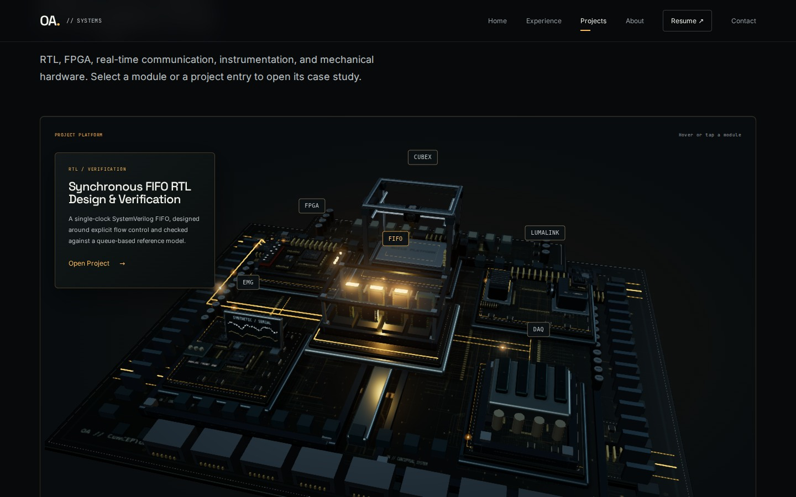
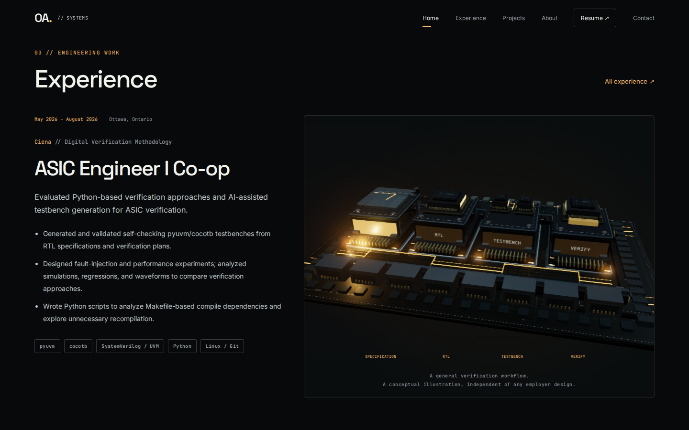
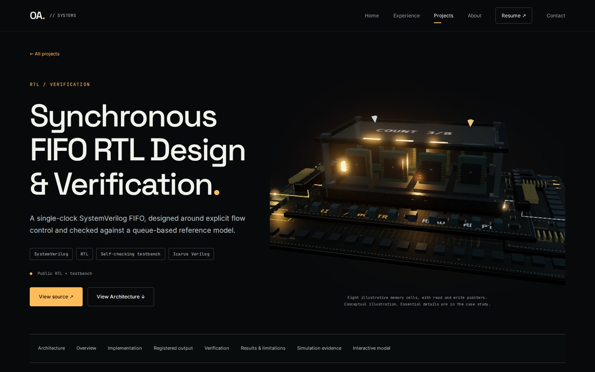
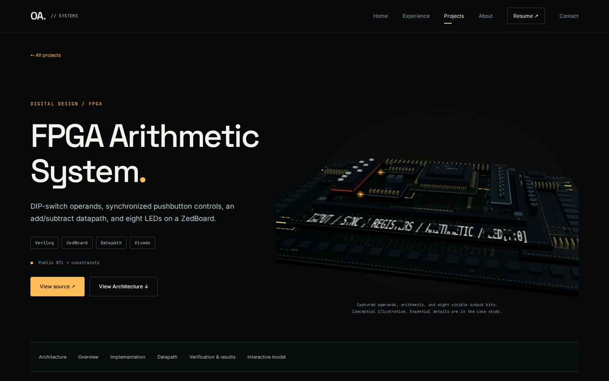
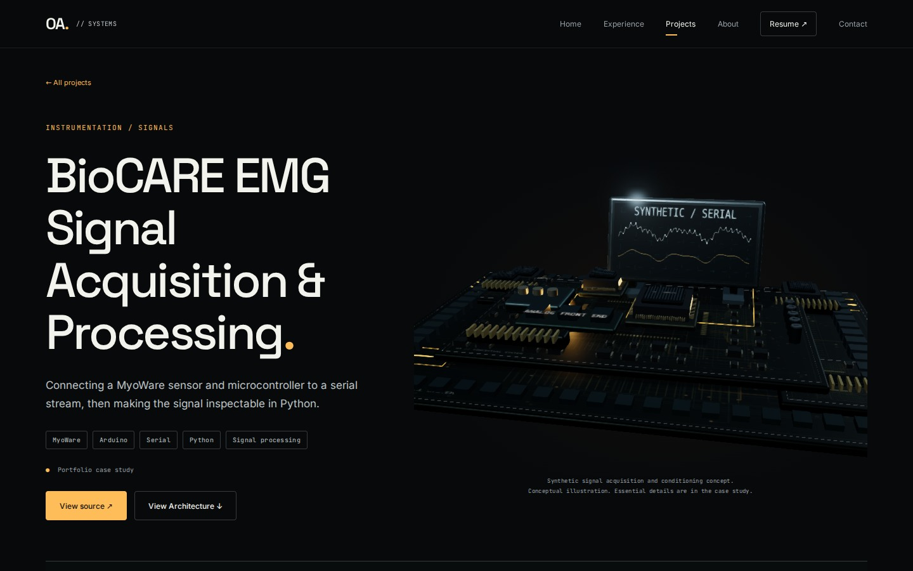
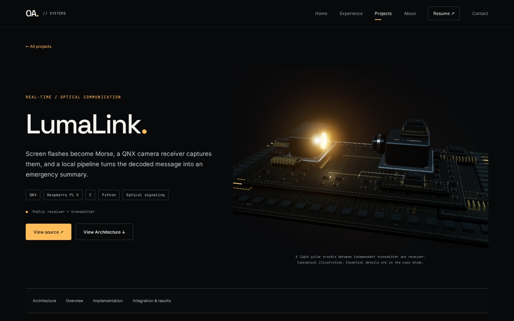
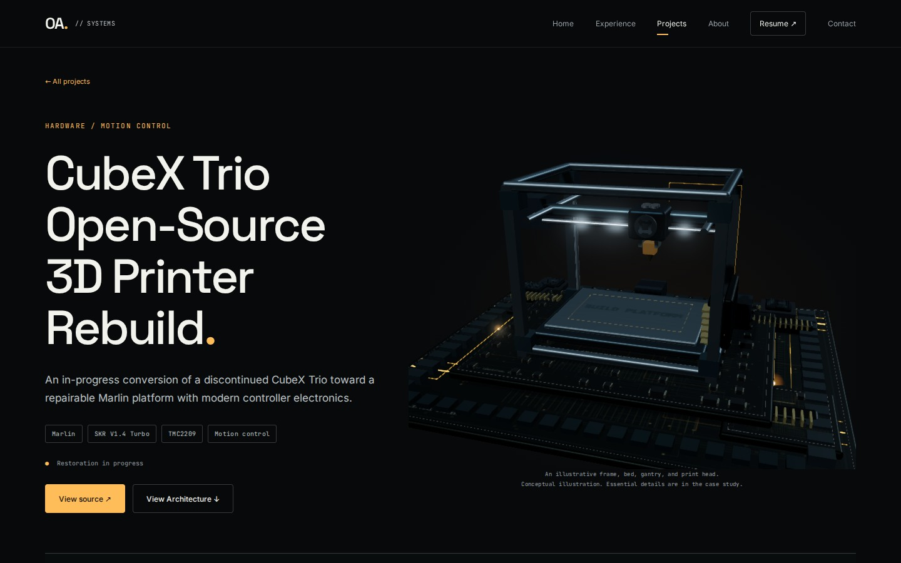

# Performance and model review

Measured at 1440 × 900 in headless Chromium using the SwiftShader **software GPU**, on a local gzip production server. One cold page load per version, followed by six seconds of frame sampling. These values describe this container, not a hardware GPU or a verified 60 fps desktop result. Frame intervals use browser requestAnimationFrame, not GPU timer queries. Heap figures are approximate JavaScript memory, not GPU memory.

| Measurement | Before | After |
| --- | ---: | ---: |
| Static hero image download (not paint) | 24.1 ms | 20.4 ms |
| First WebGL frame | Not separately instrumented | 1976 ms |
| Hero ready / interactive | 4434 ms | 2796 ms |
| Initial scene JS downloaded, gzip | 339,629 B | 341,392 B |
| Direct HeroScene / ChipLayers chunks, gzip | 3,363 B | 2,516 B |
| Active animated renderers | 1 | 1 |
| Measured DPR | 1 | 1 |
| Mean browser frame interval | 219.4 ms | 188.2 ms |
| Approximate browser FPS | 4.56 | 5.31 |
| Hero draw calls | 1284 | 278 |
| Hero triangles | 333,100 | 38,273 |
| Textures | 139 | 40 |
| Geometries | 418 | 121 |
| Approximate JS heap | 33.1 MB | 21.7 MB |
| GPU memory | Unavailable | Unavailable |

The baseline is GitHub source checkpoint `35f752f`. The static-image timing measures HTTP completion, not a first-paint timestamp. Initial scene JS counts scripts loaded through the sample; the hero chunk row excludes shared React, Three.js and renderer dependencies. Frame samples: 24 before, 31 after. Startup and rendering costs improved; initial scene JS increased slightly. Hardware GPU smoothness still needs confirmation.

Hero hydration starts on page load. The hero module, renderer code and WebGL probe load in parallel. Shared grain, pulse, board and die textures avoid per-object copies; reusable materials and instanced capacitors, contacts, framing and bolts reduce draw calls. Depth-of-field is removed, bloom is downsampled, and antialiasing uses a single FXAA path on desktop. Only one visible island animates at a time. Desktop DPR is capped at 1.25 / 1.4; mobile uses 1. Sustained poor frame time reduces DPR, then postprocessing, shadows and finally microdetail, with slower recovery to prevent oscillation. Test-only measurements remain in memory; production animation loops do not write diagnostic datasets or stringify scene state.

Validation: build and typecheck pass; eight desktop scenes captured; real 3D hover and click, HTML keyboard selection, three FIFO writes, one 390 × 844 mobile view, and one reduced-motion view passed without page errors. No Lighthouse or exhaustive matrix. Static fallbacks were exported from these interactive scenes.

These are review checkpoints. The models have stronger project identity and engineered structure, but are not declared visually finished or equivalent to the Amber + Steel reference CGI.

## Captured review scenes

| Hero | Project world |
| --- | --- |
|  |  |

| Verification | FIFO: three accepted writes |
| --- | --- |
|  |  |

| FPGA | EMG |
| --- | --- |
|  |  |

| LumaLink | CubeX |
| --- | --- |
|  |  |
