# Signal system and FIFO inspection

- Global network: sparse SVG route pulses, five current-section nodes, IntersectionObserver dominance hysteresis, and once-per-route/section activation. No continuous JS RAF; page lifecycle disposes observers/listeners.
- Project sequences: FIFO write/store/read, FPGA switches/registers/ALU/LEDs, EMG acquisition/serial/processing/synthetic waveform, LumaLink TX/light/RX/decode, CubeX electronics/toolhead/axis, and DAQ channel/sample activity. Engagement runs one short cycle and settles.
- FIFO probe: optional HTML/keyboard signal controls, one explanation at a time, architecture highlights, and one model probe label.
- Evidence: unchanged recorded Icarus VCD from public FIFO commit 89d001147d2b0298c8392bb94df0e884b1d4a063; checksum verified against existing provenance. Actual din/dout and pointer names. Reset, fill/full, drain/empty, and pointer wraps are derived from recorded states.
- Viewer: clipped Canvas 2D traces, cursor/value readout, horizontal mouse/touch pan, keyboard pan, window zoom, event jumps/highlights, and accessible definitions. No idle redraws.
- Contact: existing globe retained; background signal language and a one-session fading drag hint added. Existing form layout retained.
- Mobile/reduced motion: route travel disabled; native vertical scrolling works over the waveform. Reduced-motion content is immediately visible with static section state.
- Validation: production build, typecheck, changed-file lint, all 14 tests, six project engagements, both camera transitions, full requested route stress sequence/Back, keyboard/mouse/touch input, Contact drag/hint, and reduced motion passed. No page errors. One pre-existing Astro hint remains.
- Limitations: software SwiftShader measurements, no hardware FPS claim or controlled before/after benchmark. Adaptive quality changes between samples. The recording is DEPTH=4; the existing 3D FIFO is an eight-cell illustration. No simultaneous-transfer annotation is fabricated. Optional hero inspection/pointer-background extras were omitted to preserve homepage clarity.

## Representative measurements

| Sample | Result |
|---|---|
| Home | 1 active renderer; 269 draw calls; first WebGL frame ~4.76s |
| Projects idle | 491 draw calls at sampled adaptive tier |
| Project engagements | 412–418 calls as adaptive quality changes |
| FIFO waveform in view | 0 active WebGL renderers; 0 idle waveform redraws |
| Global background | SVG/CSS, one section observer; no continuous JS RAF |

## Captures

### Homepage idle

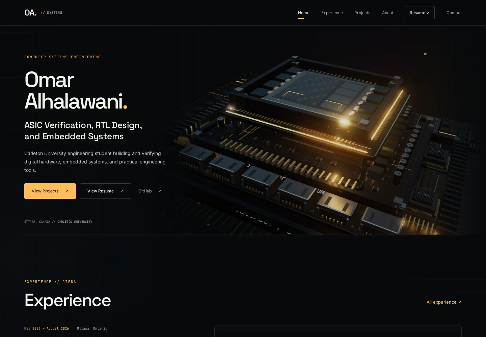

### Pointer-reactive hero

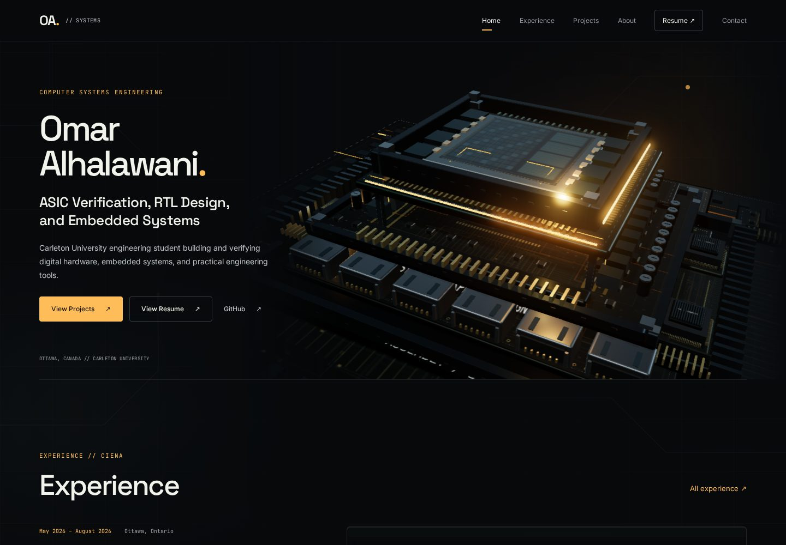

### Experience entry signal

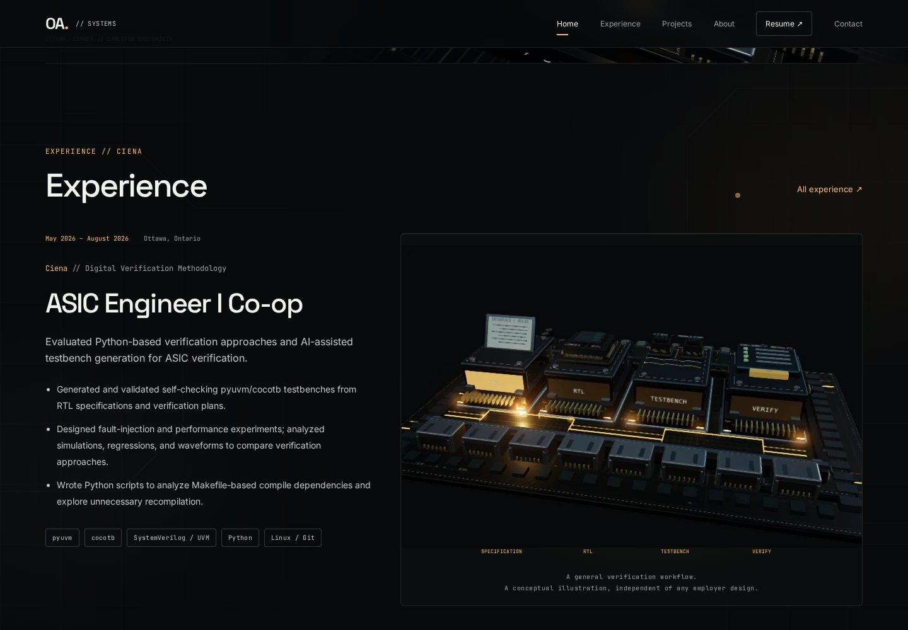

### Verification sequence

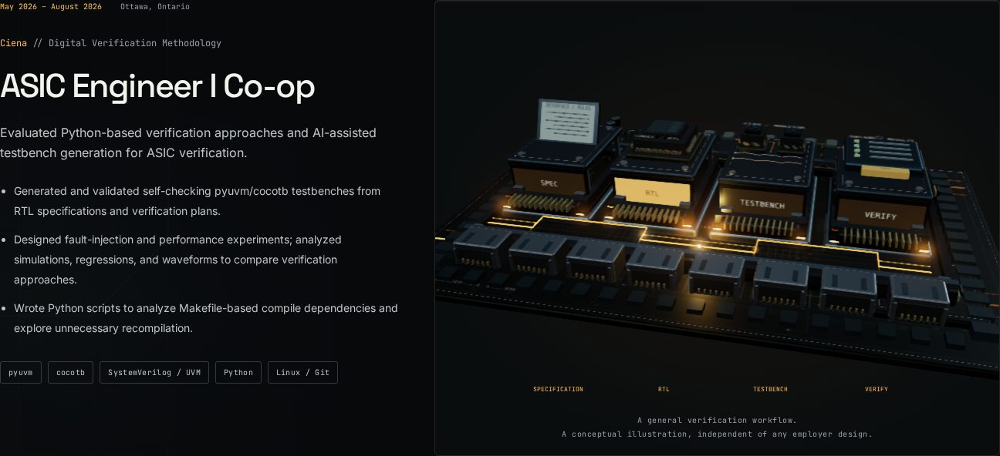

### Project platform idle

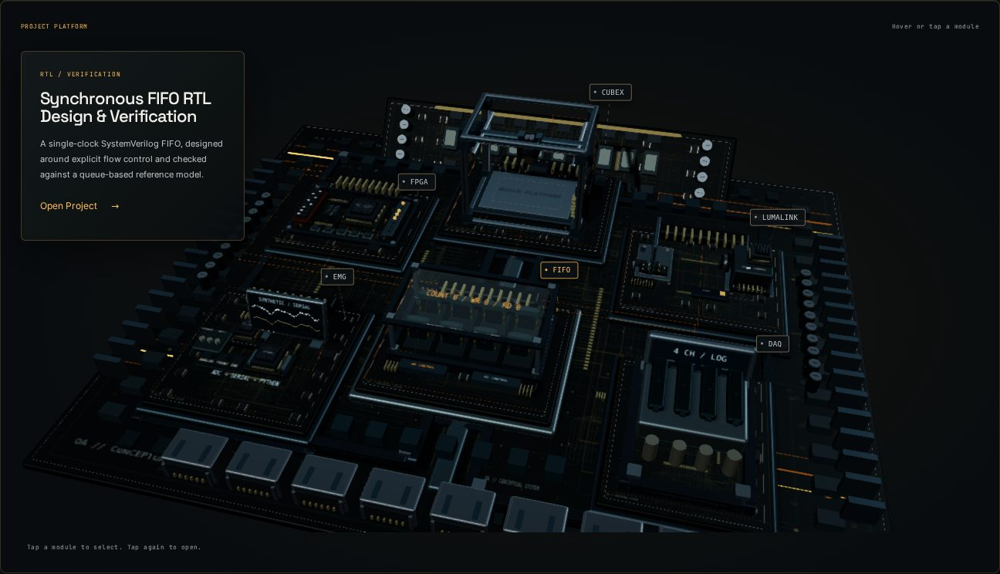

### FIFO engaged

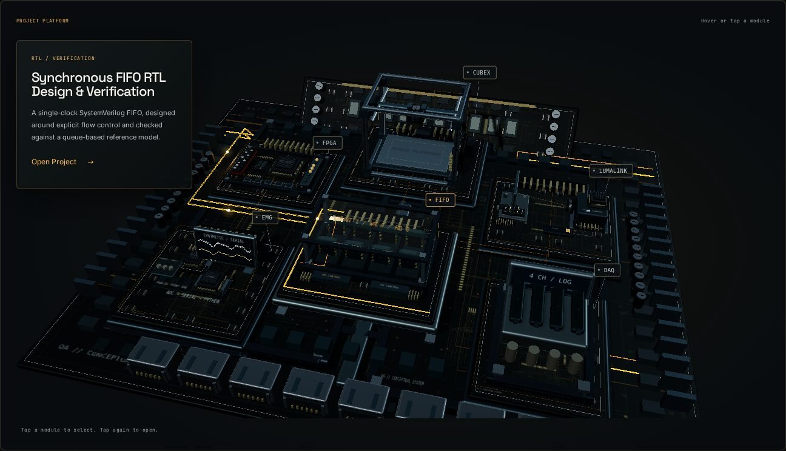

### FPGA engaged

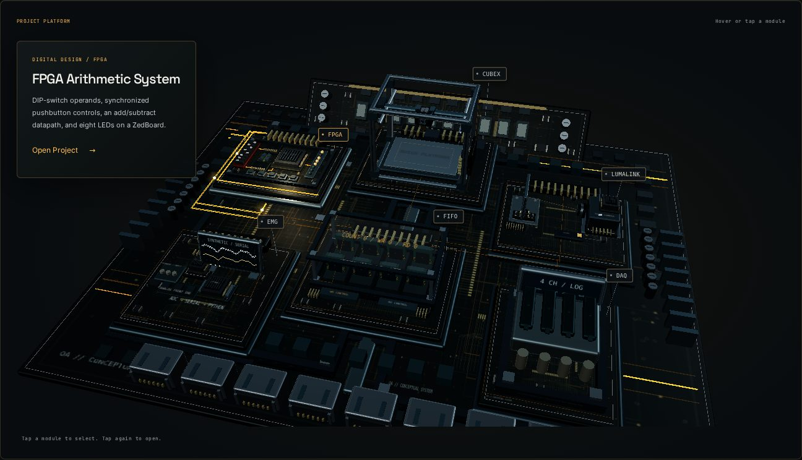

### LumaLink engaged

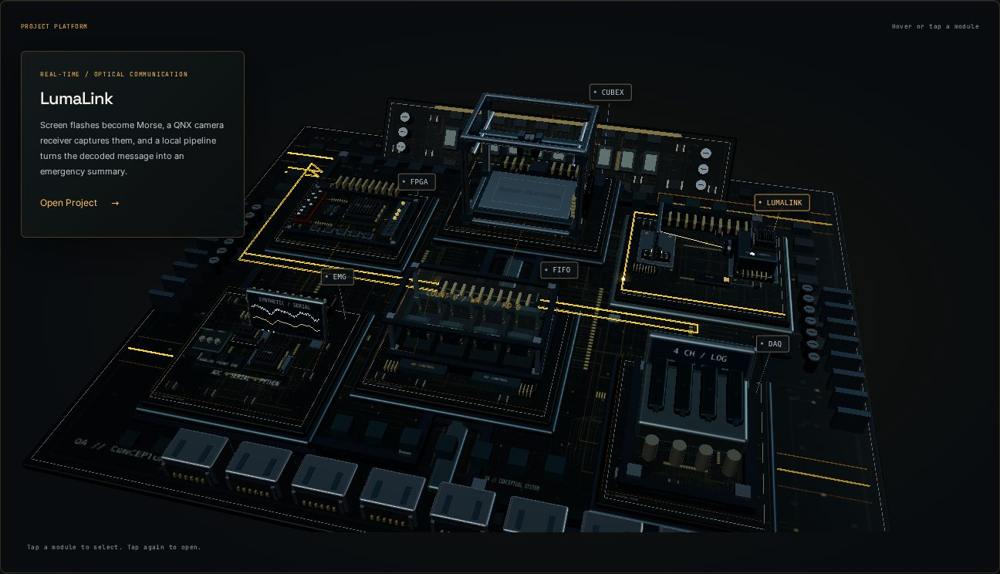

### CubeX engaged

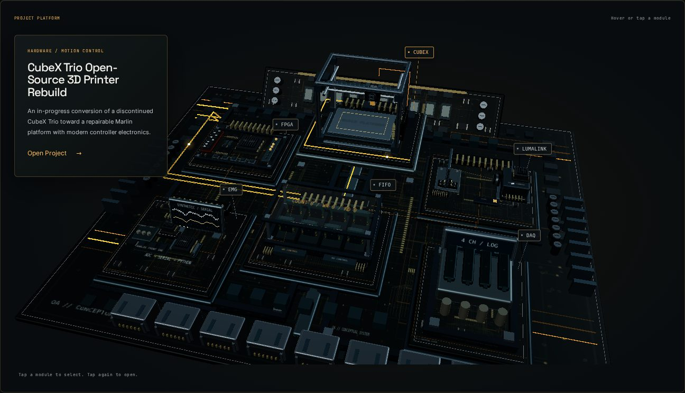

### FIFO inspection

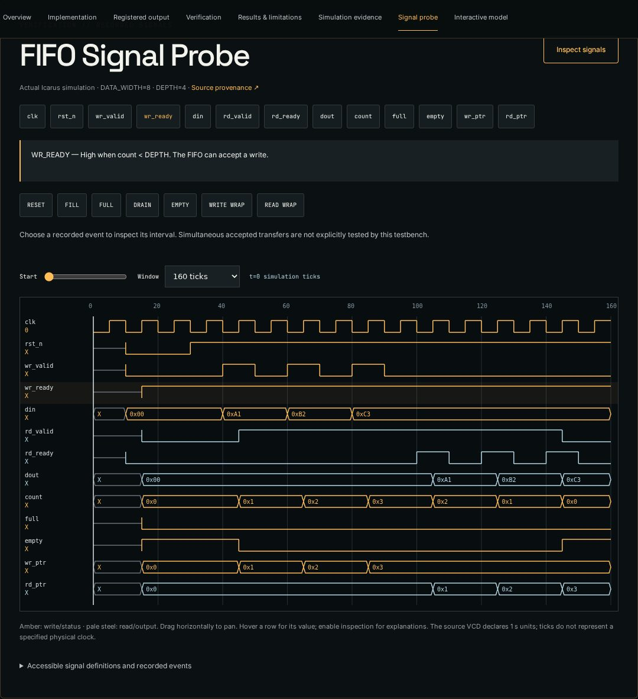

### Real FIFO waveform

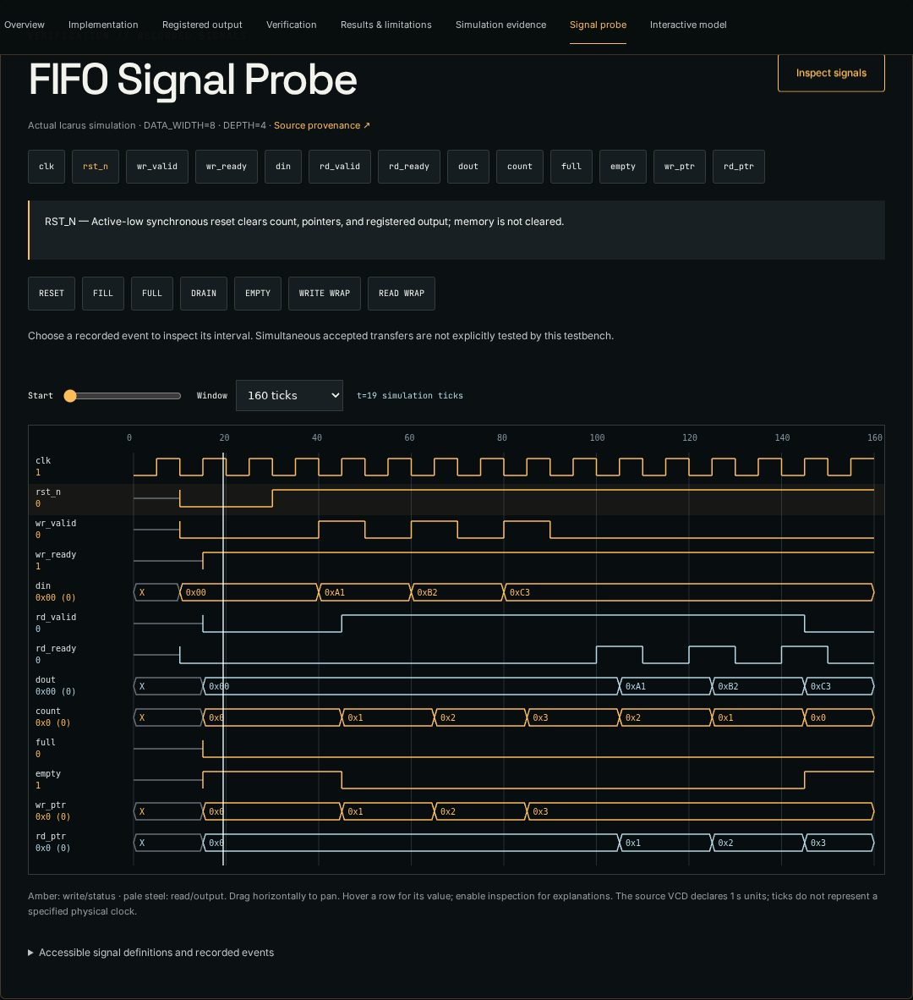

### Recorded FULL event

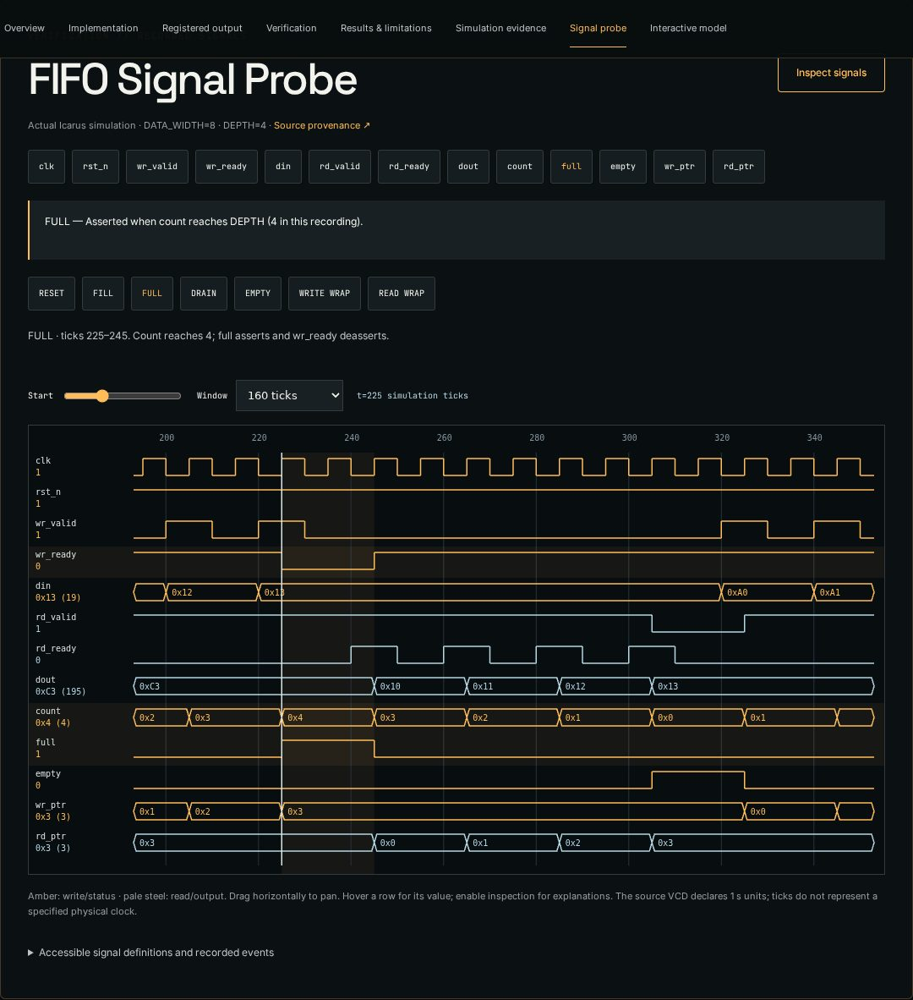

### Contact continuity

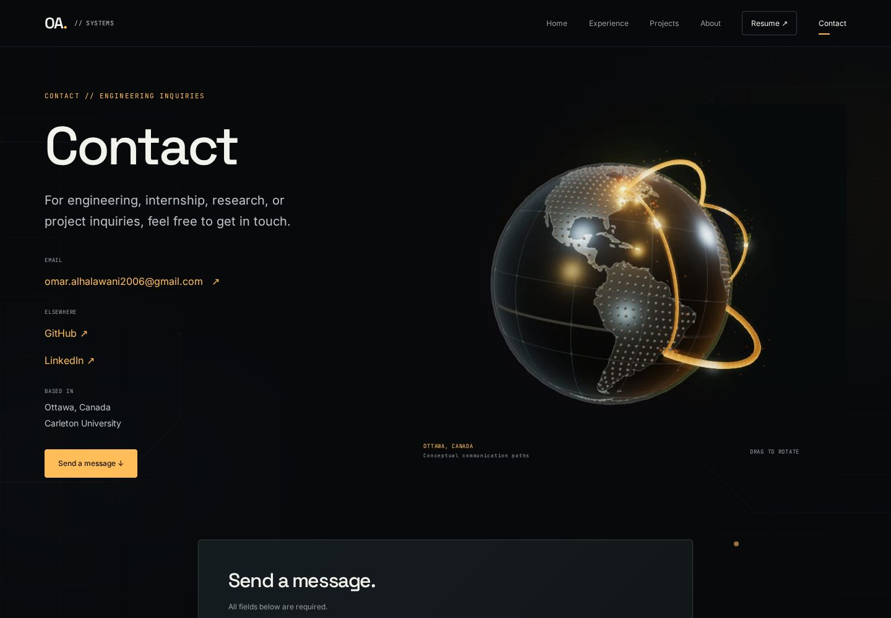

### Mobile homepage

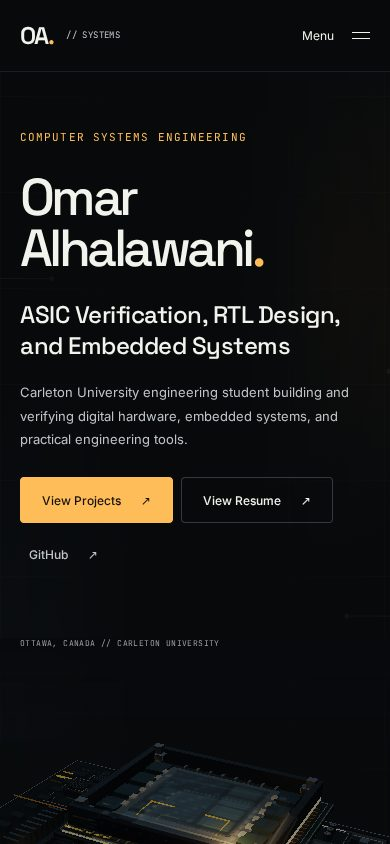

### Mobile FIFO inspection

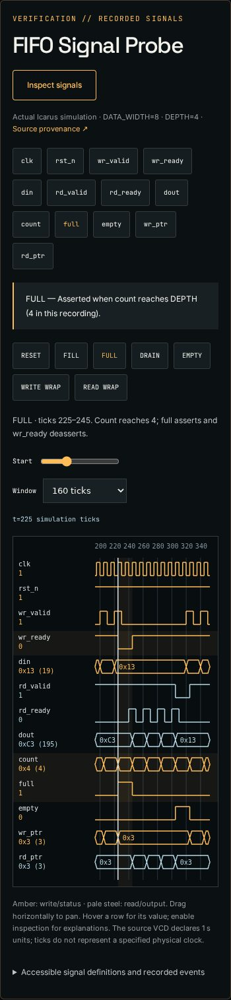

### Reduced-motion homepage

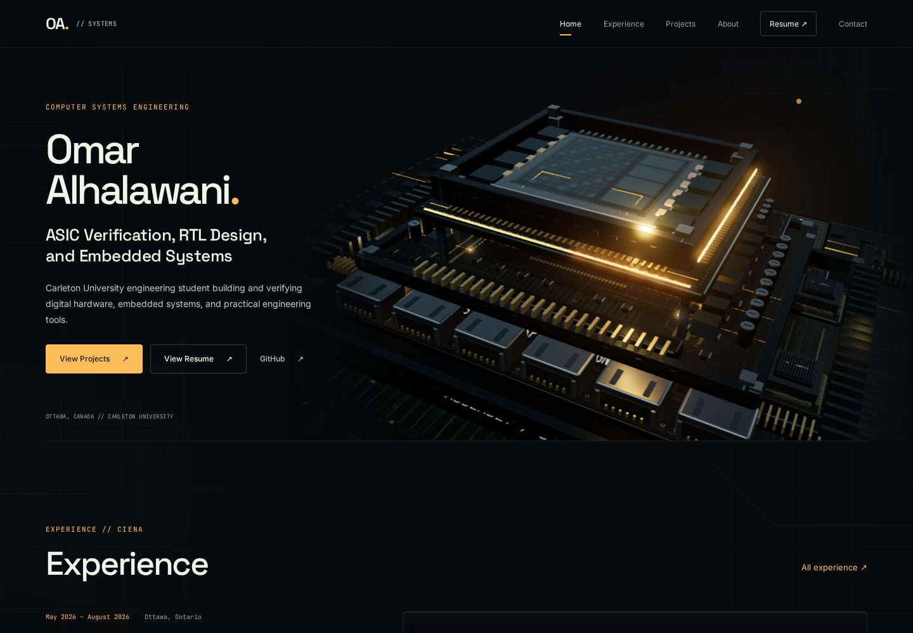
