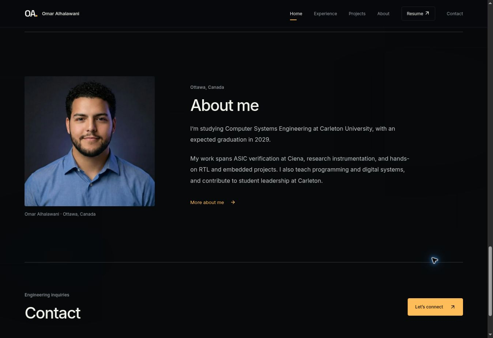

# Visual refinement

The portfolio now uses Omar's actual name in the header/footer, a natural-color portrait on the homepage, plainer labels, readable project summaries and calmer section typography. Project and verification panels use flat surfaces and thin rules. Skill labels are plain text; ambient gradients and the decorative grid have been reduced. Amber remains the action/engineering accent.

Navigation and action arrows use a shared inline SVG component, fixing missing-font glyph boxes observed in the browser. Existing 3D scenes, lighting, animation timelines, navigation transitions, factual project data, resume file and contact delivery logic remain intact.

The development command includes Astro's documented `--ignore-lock` foreground option so the managed preview owns the server process instead of losing it to automatic backgrounding.

Validation: production build and typecheck passed. Desktop homepage and Home → Projects navigation were checked in the managed cloud browser; no horizontal overflow was observed. That browser has WebGL disabled, so scene fallback artwork was reviewed rather than animation playback. Mobile styles are retained; no physical-device test was performed in this pass.

